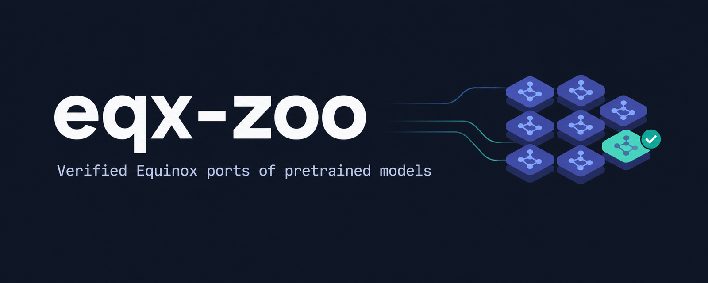

<p align="center">
  
</p>

<p align="center">
<a href="https://github.com/xquantize/eqx-zoo/actions/workflows/ci.yml"></a>
<a href="https://pypi.org/project/eqx-zoo/"></a>
<a href="https://github.com/xquantize/eqx-zoo/blob/main/LICENSE"></a>

<a href="https://github.com/patrick-kidger/equinox"></a>
</p>

eqx-zoo provides pretrained models as plain [Equinox](https://github.com/patrick-kidger/equinox) modules, loaded straight from Hugging Face checkpoints and numerically verified against their reference implementations: language models against 🤗 Transformers, and sentence-embedding models against [sentence-transformers](https://www.sbert.net). Since Transformers v5 removed its JAX models, eqx-zoo is a verified way to keep using them in JAX.

Every model is an ordinary pytree, so `jax.jit`, `jax.grad`, `jax.vmap` and the rest of the JAX ecosystem work on it directly.

## Installation

```bash
pip install eqx-zoo
```

Requires Python 3.12+. The example below also uses `pip install tokenizers`.

On Linux with an NVIDIA GPU (including WSL2 on Windows), install the `cuda` extra to get JAX's CUDA build: `pip install "eqx-zoo[cuda]"`. On macOS and native Windows, JAX runs on the CPU and the extra changes nothing. For older drivers that need CUDA 12, install `jax[cuda12]` at the same version as `jax` instead.

## Quick example

```python
import jax.numpy as jnp
from tokenizers import Tokenizer

from eqx_zoo import CausalLM, generate

tokenizer = Tokenizer.from_pretrained("Qwen/Qwen3-0.6B")
model = CausalLM.from_pretrained("Qwen/Qwen3-0.6B")

prompt = jnp.array(tokenizer.encode("The capital of France is").ids)
tokens = generate(model, prompt, max_new_tokens=30)
print(tokenizer.decode(tokens.tolist()))
# Paris. The capital of Italy is Rome. The capital of Spain is Madrid. ...
```

## Batched generation

Prompts of different lengths are left-padded and generated together. With greedy decoding, each row is identical to generating that prompt on its own.

```python
from eqx_zoo import generate_batch

tokenizer.enable_padding(direction="left")
prompts = ["The capital of France is", "The largest planet in the solar system is"]
batch = tokenizer.encode_batch(prompts)

ids = jnp.array([e.ids for e in batch])
mask = jnp.array([e.attention_mask for e in batch])
tokens = generate_batch(model, ids, mask, max_new_tokens=20)
```

## Sentence embeddings

`Encoder.embed` reads each checkpoint's sentence-transformers configuration and applies its own pooling and normalisation, so embeddings match sentence-transformers.

```python
import jax
import jax.numpy as jnp
from tokenizers import Tokenizer

from eqx_zoo import Encoder

tokenizer = Tokenizer.from_pretrained("sentence-transformers/all-MiniLM-L6-v2")
tokenizer.enable_padding()
model = Encoder.from_pretrained("sentence-transformers/all-MiniLM-L6-v2")

batch = tokenizer.encode_batch(["The cat sits on the mat.", "A feline rests on a rug."])
ids = jnp.array([e.ids for e in batch])
mask = jnp.array([e.attention_mask for e in batch])
embeddings = jax.vmap(model.embed)(ids, mask)
print(embeddings @ embeddings.T)  # cosine similarities, as the embeddings are normalised
```

Decoder-based embedding models such as Qwen3-Embedding work the same way, through `DecoderEmbedder`. For search, queries take the instruction prompt from the model's sentence-transformers configuration; documents are embedded as they are.

```python
from eqx_zoo import DecoderEmbedder

model = DecoderEmbedder.from_pretrained("Qwen/Qwen3-Embedding-0.6B")
tokenizer = Tokenizer.from_pretrained("Qwen/Qwen3-Embedding-0.6B")
tokenizer.enable_padding()

prompt = (
    "Instruct: Given a web search query, retrieve relevant passages that answer the query\nQuery:"
)
batch = tokenizer.encode_batch(
    [prompt + "What is the capital of France?", "Paris is the capital of France."]
)
ids = jnp.array([e.ids for e in batch])
mask = jnp.array([e.attention_mask for e in batch])
query, passage = jax.vmap(model.embed)(ids, mask)
print(query @ passage)  # cosine similarity
```

Some checkpoints have no sentence-transformers pipeline, so their model card states the pooling instead. Pass it to `from_pretrained`, and `save_pretrained` will write matching sentence-transformers files, so the saved model loads with the same pooling there too:

```python
model = Encoder.from_pretrained("ncbi/MedCPT-Query-Encoder", pooling="cls")
```

## Saving models

Models loaded with `from_pretrained` can be saved back in Hugging Face format, for example after fine-tuning, so that Transformers, sentence-transformers or the Hub can use them:

```python
model = Encoder.from_pretrained("sentence-transformers/all-MiniLM-L6-v2")
# ... fine-tune with any JAX optimiser ...
model.save_pretrained("my-embedder")
```

`save_pretrained` writes the original `config.json` (with its dtype updated), any sentence-transformers configuration, and the weights as safetensors. The tokenizer isn't part of the model, so save it alongside, for example with `AutoTokenizer.from_pretrained("sentence-transformers/all-MiniLM-L6-v2").save_pretrained("my-embedder")`. Saving is verified by loading the result with Transformers and sentence-transformers and reproducing the reference outputs. For a complete example, fine-tuning all-MiniLM-L6-v2 with Optax and using the result from sentence-transformers, see [`examples/finetune_embeddings.py`](https://github.com/xquantize/eqx-zoo/blob/main/examples/finetune_embeddings.py).

Multimodal checkpoints such as Qwen3.5's are saved as their text-only language model (for example `Qwen3_5ForCausalLM`), since eqx-zoo loads only the language model.

## LoRA fine-tuning

`eqx_zoo.lora` adds [LoRA](https://arxiv.org/abs/2106.09685) adapters to language models, compatible with Hugging Face's [PEFT](https://github.com/huggingface/peft): you can train an adapter in JAX and use it from PEFT, or load a PEFT adapter from the Hub. eqx-zoo reads and writes PEFT's file format, so it doesn't depend on PEFT itself.

```python
import equinox as eqx
import jax
from eqx_zoo import CausalLM, lora

model = CausalLM.from_pretrained("Qwen/Qwen3-0.6B")
model = lora.add_adapter(
    model, r=8, alpha=16, target_modules=["q_proj", "v_proj"], key=jax.random.key(0)
)

# Train only the adapter: `trainable` marks its arrays, and everything else stays frozen.
trainable, frozen = eqx.partition(model, lora.trainable(model))
# ... optimise `trainable` with any JAX optimiser, calling eqx.combine(trainable, frozen) ...
model = eqx.combine(trainable, frozen)

lora.save_adapter(model, "my-adapter")  # PEFT loads it with PeftModel.from_pretrained

# Load an adapter from the Hub, then fold it into the weights to save an ordinary model.
base = CausalLM.from_pretrained("Qwen/Qwen3-0.6B")
model = lora.load_adapter(base, "phh/Qwen3-0.6B-TLDR-Lora")
lora.merge(model).save_pretrained("qwen3-tldr")
```

`save_pretrained` refuses a model that has an adapter, since the adapter's layers would be saved under the wrong names: merge it first, or save the adapter alone with `save_adapter`. For a complete example, training an adapter for SmolLM2-135M with Optax and checking it in PEFT, see [`examples/lora_finetune.py`](https://github.com/xquantize/eqx-zoo/blob/main/examples/lora_finetune.py).

Supported: `CausalLM` (Llama, Qwen, Mistral), `GPT2` and `GPTNeoX` models; plain LoRA, rank-stabilised LoRA (`rslora`) and `lora_bias`; and PEFT's `target_modules` semantics (names matched as suffixes, regular expressions, or `"all-linear"`). A model has one adapter, kept in float32 as in PEFT. Not supported yet, and refused with an error: DoRA, `modules_to_save`, per-module ranks or alphas, trained biases, dropout in training (`lora_dropout` is accepted when loading, as it doesn't affect inference), Qwen3.5 and mixture-of-experts models, and encoders.

Adapters are verified against PEFT: on tiny models, forward outputs and the gradients of the adapter's weights match; PEFT adapters load here and adapters saved here load in PEFT, with the same logits; and a merged model matches `merge_and_unload` and loads in Transformers. Real Hub adapters reproduce PEFT's logits and greedy tokens on their base checkpoints: [phh/Qwen3-0.6B-TLDR-Lora](https://huggingface.co/phh/Qwen3-0.6B-TLDR-Lora), [ali4566544/qwen2.5-0.5b-instruct-python-lora](https://huggingface.co/ali4566544/qwen2.5-0.5b-instruct-python-lora), [hfm8tr/smollm2-135m-smoltalk-lora](https://huggingface.co/hfm8tr/smollm2-135m-smoltalk-lora), and, with `rslora`, [socius/Llama-Centaur-1B-LoRA-r4](https://huggingface.co/socius/Llama-Centaur-1B-LoRA-r4).

## Models

Any checkpoint with a supported architecture loads with `CausalLM.from_pretrained` or `Encoder.from_pretrained`, from the Hugging Face Hub or a local directory. These checkpoints are verified by the test suite, and collected on the Hugging Face Hub in [Verified in eqx-zoo](https://huggingface.co/collections/xquantize/verified-in-eqx-zoo-6ac2d731fd1ef3e109541bf7).

### Language models (`CausalLM`)

| Architecture | Verified checkpoints |
|---|---|
| `LlamaForCausalLM` | [SmolLM2-135M](https://huggingface.co/HuggingFaceTB/SmolLM2-135M), [Llama 3.2 1B](https://huggingface.co/meta-llama/Llama-3.2-1B), [SmolLM2-360M](https://huggingface.co/HuggingFaceTB/SmolLM2-360M) |
| `GPT2LMHeadModel` | [GPT-2](https://huggingface.co/openai-community/gpt2) (load with `GPT2.from_pretrained`; same interface as `CausalLM`) |
| `GPTNeoXForCausalLM` | [Pythia-160M](https://huggingface.co/EleutherAI/pythia-160m) (load with `GPTNeoX.from_pretrained`; same interface as `CausalLM`; parallel and sequential residuals are both supported, the sequential one verified on a tiny model against Transformers) |
| `MistralForCausalLM` | [nano-mistral](https://huggingface.co/crumb/nano-mistral) (Mistral-7B v0.3 shares the architecture; sliding-window checkpoints such as Mistral-7B v0.1 are supported too, verified on a tiny model with a 4-token window against Transformers) |
| `Qwen3ForCausalLM` | [Qwen3-0.6B](https://huggingface.co/Qwen/Qwen3-0.6B) |
| `Qwen2ForCausalLM` | [Qwen2.5-0.5B](https://huggingface.co/Qwen/Qwen2.5-0.5B) |
| `Qwen3_5ForConditionalGeneration` | [Qwen3.5-0.8B](https://huggingface.co/Qwen/Qwen3.5-0.8B) (language model; hybrid Gated DeltaNet and attention) |
| `Qwen3MoeForCausalLM` | [MiniMind-3 MoE](https://huggingface.co/jingyaogong/minimind-3-moe) |

Mixture-of-experts models, including [Qwen3-30B-A3B](https://huggingface.co/Qwen/Qwen3-30B-A3B), use the same `Qwen3MoeForCausalLM` architecture; experts are computed with grouped matrix multiplications. `generate_batch` currently processes their prompts one after another ([#23](https://github.com/xquantize/eqx-zoo/issues/23)).

### Encoders and embedding models (`Encoder`)

| Architecture | Verified checkpoints |
|---|---|
| `BertModel` | [all-MiniLM-L6-v2](https://huggingface.co/sentence-transformers/all-MiniLM-L6-v2), [bge-small-en-v1.5](https://huggingface.co/BAAI/bge-small-en-v1.5), [multilingual-e5-small](https://huggingface.co/intfloat/multilingual-e5-small), [MedCPT query](https://huggingface.co/ncbi/MedCPT-Query-Encoder) and [article](https://huggingface.co/ncbi/MedCPT-Article-Encoder) encoders (with `pooling="cls"`) |
| `XLMRobertaModel` | [multilingual-e5-base](https://huggingface.co/intfloat/multilingual-e5-base) |

`RobertaModel` shares the XLM-RoBERTa implementation and is verified on tiny random models.

### Decoder embedding models (`DecoderEmbedder`)

| Architecture | Verified checkpoints |
|---|---|
| `Qwen3ForCausalLM` (saved without a head) | [Qwen3-Embedding-0.6B](https://huggingface.co/Qwen/Qwen3-Embedding-0.6B) |

### Verification

Language models are tested against Hugging Face activations in two tiers:

- **float32:** every layer's output must match, and greedy generation must reproduce the reference output token for token.
- **bfloat16:** logits must be about as accurate as Hugging Face's own bfloat16, measured against its float32 output. Exact greedy agreement isn't required in bf16, since near-tied decisions flip even in Hugging Face's own bf16. Instead, on a 512-token input, bf16 decisions must match float32's wherever float32 is confident (its top two logits differ by more than 8 times Hugging Face's own bf16 noise), both in a full forward pass and in cached decoding. Precision-critical blocks (attention's softmax and LayerNorm) are also tested directly in bf16 against the reference arithmetic.

Encoders and decoder embedders are tested layer by layer against Hugging Face, and their embeddings must match sentence-transformers for a padded batch of sentences, in float32. In bfloat16, their hidden states and embeddings must be about as accurate as the reference libraries' own bfloat16.

On GPUs and TPUs, JAX's default float32 matrix multiplications may use reduced precision internally (TF32 on recent NVIDIA GPUs, bfloat16 on TPUs), so float32 results can differ noticeably from a float32 reference. Request the most accurate setting, which is true float32 on GPUs and close to it on TPUs, with `jax.config.update("jax_default_matmul_precision", "highest")`, or `with jax.default_matmul_precision("highest"):` for a block of code. Setting the environment variable `JAX_DEFAULT_MATMUL_PRECISION=highest` does the same without changing any code, which is a quick way to check whether precision explains a difference. The test suite requests highest precision.

Every architecture is also tested on tiny randomly initialised models, which cover code paths that no single checkpoint exercises. See [`tests/`](https://github.com/xquantize/eqx-zoo/tree/main/tests).

## Development

```bash
git clone https://github.com/xquantize/eqx-zoo && cd eqx-zoo
uv sync
uv run pytest                              # fast: tiny models and unit tests, no downloads
uv run pytest --checkpoint smollm2-135m    # one pretrained checkpoint, as CI runs them
scripts/test-checkpoints.sh                # every checkpoint, one process each
uv run python benchmarks/generation.py Qwen/Qwen3-0.6B   # load, compile and throughput
```

Contributions are welcome. See [`CONTRIBUTING.md`](https://github.com/xquantize/eqx-zoo/blob/main/CONTRIBUTING.md) for setup, conventions and how to add a model.

## See also

- **Neural networks:** [Equinox](https://github.com/patrick-kidger/equinox).
- **Typing:** [jaxtyping](https://github.com/patrick-kidger/jaxtyping).
- **Other JAX model collections:** [Levanter](https://github.com/stanford-crfm/levanter) (LLM training), [Bonsai](https://github.com/jax-ml/bonsai) (Flax NNX), [Equimo](https://github.com/RhizomeResearch/Equimo) (vision).

## License

Apache 2.0. Pretrained weights are distributed by their original authors under their own licenses.
